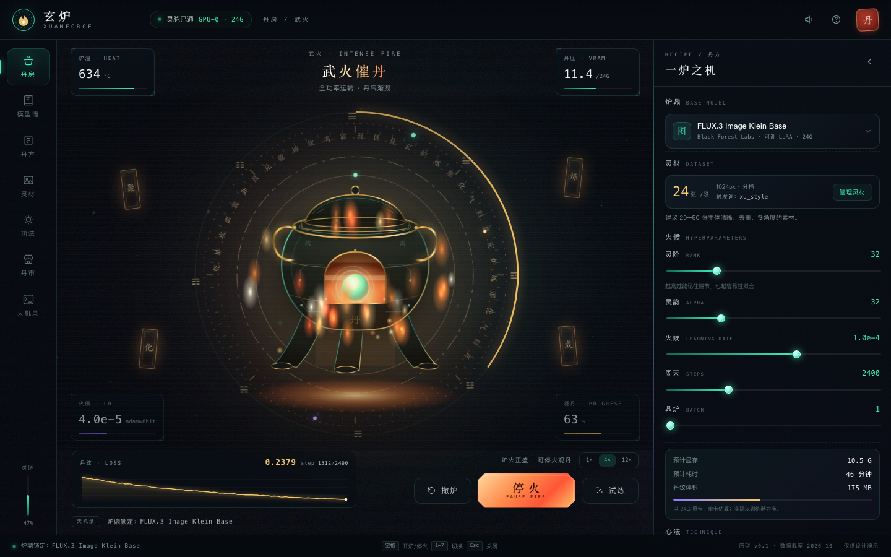
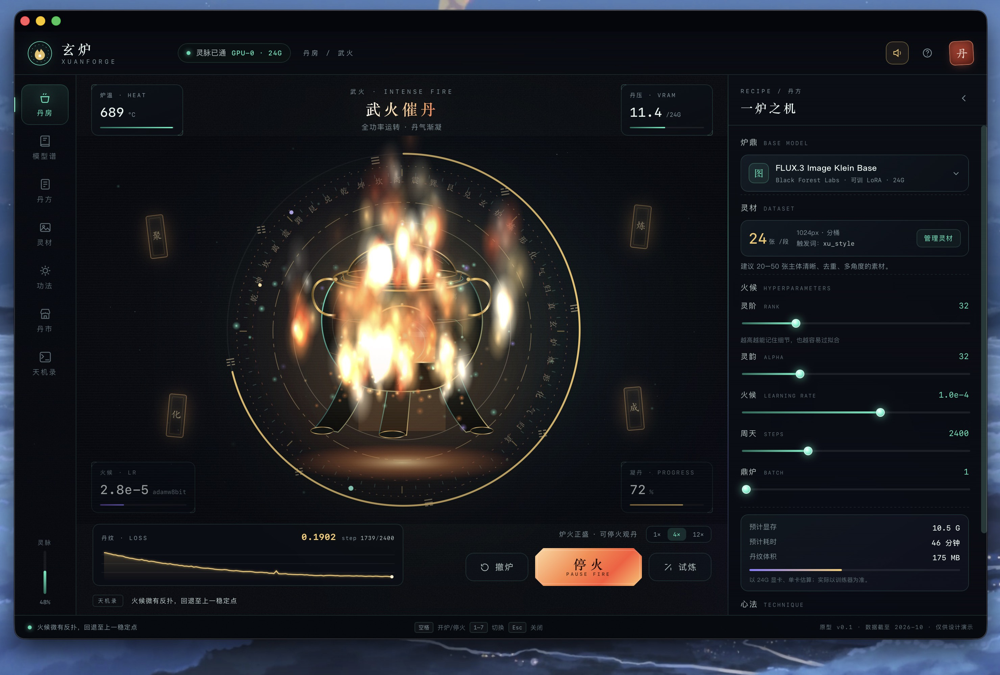
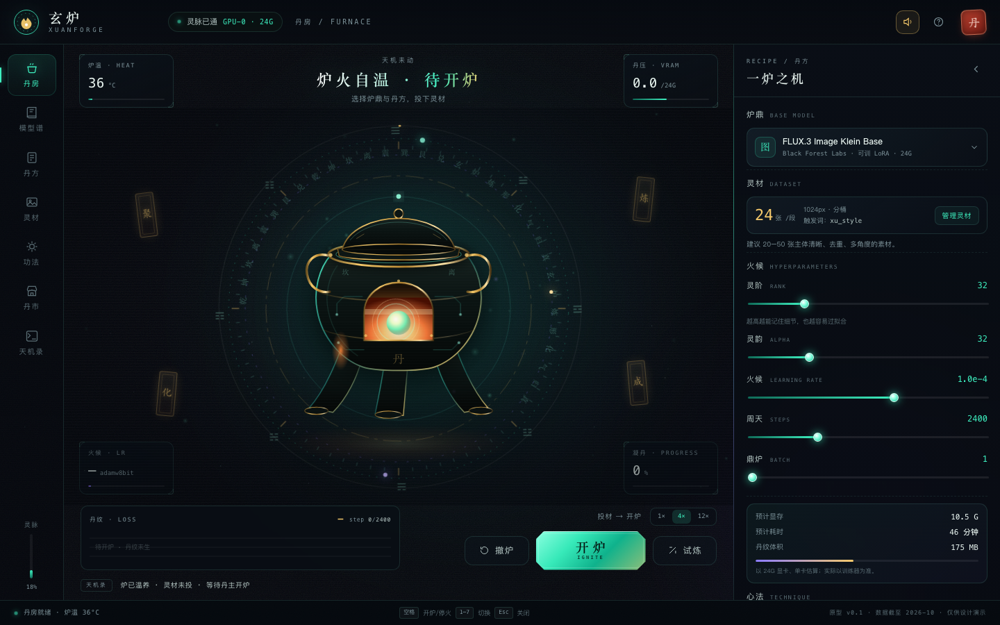
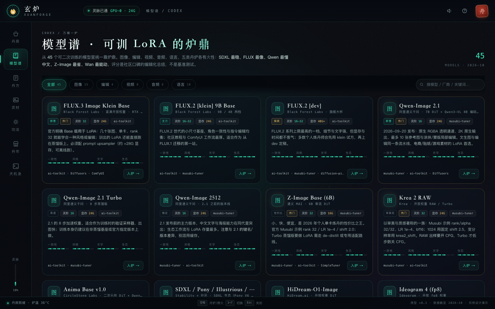
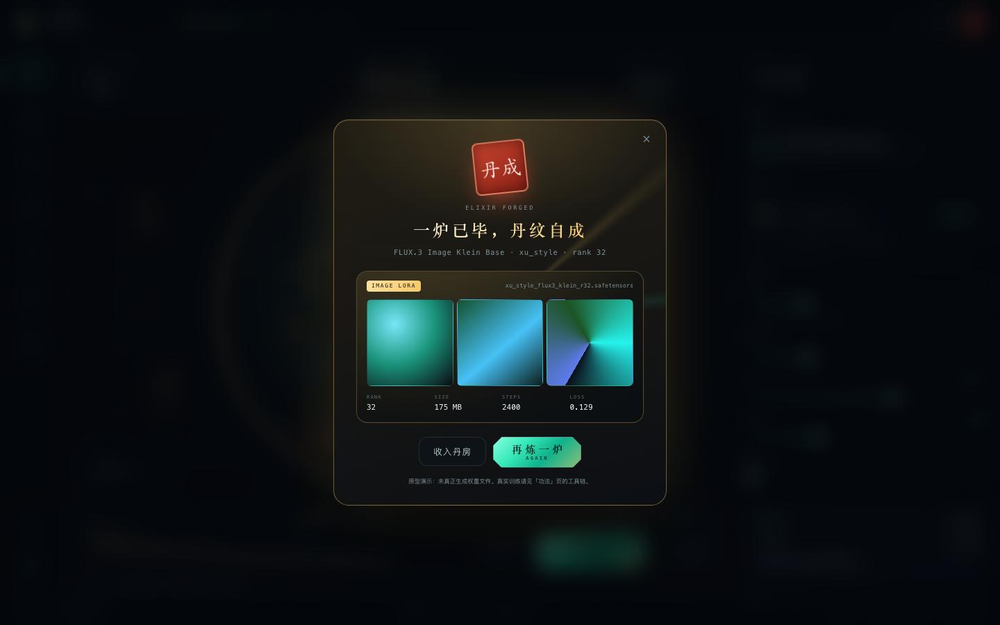

# 玄炉 XUANFORGE · 赛博炼丹炉 LoRA 训练台

[](LICENSE)
[](desktop/README.md)
[](#这是什么)
[](https://cyq131515.github.io/xuanforge/)

> 「一炉一气，炼万千形态。」
> 把图像、视频、音频、语言的 LoRA 训练，做成一座可以观火、候丹、留影的赛博炼丹炉。



---

## 这是什么

这是一份**可交互的产品原型**：不是设计稿，也不是截图墙，而是一个能真的点开、开炉、换炉鼎、调火候、看丹成的网页应用。

- **零依赖、零构建**：纯 HTML + CSS + 原生 JS，双击 `index.html` 就能打开；也可用任意静态服务器托管。
- **一座炉**：Canvas 粒子 + SVG 炉体 + CSS 光效组成赛博炼丹炉；开炉时炉火从文火转武火，丹气上升、符文环加速、炉盖浮起，训练结束「丹成」并弹出丹纹卡片。
- **一套真实资料库**：45 个可训 LoRA 的模型、13 条有出处的丹方、14 个训练器、12 个社区平台，全部来自 2026-10 的官方文档与公开资料。详见 [`docs/LoRA生态调查-2026.md`](docs/LoRA生态调查-2026.md)。

> 训练是**模拟**的：原型不下载权重、不调用 GPU、不生成 safetensors。它验证的是产品体验、信息架构与视觉方向。

## 桌面版（macOS）

已经打包成原生桌面应用：**Swift + WKWebView**，独立窗口、原生菜单、全屏、Dock 图标，通用二进制（Apple Silicon + Intel），应用本体约 2 MB。



- 构建：`bash desktop/macos/build.sh` → `dist/玄炉.app` + `dist/玄炉-macOS.zip`
- 运行：`open dist/玄炉.app`，或解压 ZIP 后拖进「应用程序」
- 构建产物不入库；详细说明见 [desktop/README.md](desktop/README.md)

### 一眼看全

| 丹房 · 待机 | 丹房 · 武火 |
|---|---|
|  |  |

| 模型谱 | 丹成 |
|---|---|
|  |  |

更多：[丹方](screenshots/04-recipes.png) · [灵材](screenshots/05-materials.png) · [丹市](screenshots/06-market.png) · [观炉须知](screenshots/08-guide.png) · [移动端](screenshots/09-mobile.png)

---

## 怎么打开

**在线预览**：<https://cyq131515.github.io/xuanforge/>

**方式一（最简单）**：双击仓库根目录的 `index.html`。

**方式二（推荐，便于截图与调试）**：在仓库根目录起静态服务：

```bash
python3 -m http.server 8765
# 打开 http://127.0.0.1:8765/
```

**快捷键**：`空格` 开炉 / 停火 / 续火 ｜ `1–7` 切换页面 ｜ `Esc` 关闭弹层。

**隐藏的演示参数**（方便演示与验收）：

| URL | 效果 |
|---|---|
| `?demo=burn&p=0.72` | 直接进入「武火」燃烧态 |
| `?demo=done` | 直接走到「丹成」并弹出丹纹卡 |
| `?demo=trial` | 自动开始一次「试炼」快跑 |
| `?view=codex` | 直接打开模型谱（同理 recipes / materials / methods / market / logs） |

---

## 七个页面

| 页面 | 它回答的问题 | 关键交互 |
|---|---|---|
| **丹房 Furnace** | 现在炼到哪一步了？ | 开炉 / 停火 / 续火、撤炉、试炼、演示速度 1×/4×/12×、实时炉温/丹压/火候/凝丹、loss 丹纹曲线、天机录滚动日志 |
| **模型谱 Codex** | 什么模型可以训 LoRA？ | 按图像/编辑/视频/音频/语言筛选、搜索、口碑雷达、一键「入炉」 |
| **丹方 Recipes** | 这个模型该用什么参数？ | 13 张有出处的配方卡，一键套用（模型 + rank + LR + 步数同步到丹房） |
| **灵材 Materials** | 我的数据够不够好？ | 真实拖拽本地图片（仅本地预览）、触发词、数据体检、标注预览、数据原则 |
| **功法 Methods** | 怎么学、用什么工具？ | LoRA/LoHa/LoKr/DoRA/PiSSA 心法、14 个训练器对比表、避坑清单、资料来源 |
| **丹市 Market** | 去哪下模型、发丹纹？ | Civitai / LiblibAI / HF / 魔搭 / 音频社区 / 云算力，含选择指南与许可提醒 |
| **天机录 Logs** | 每一炉留下了什么？ | 实时日志、历史丹纹档案、导出 `.txt` |

---

## 设计说明

### 视觉方向：科技 × 修仙

- **底色**：近黑的墨色（`#04060c`）+ 青玉灵光（`#3ef0c0`）+ 丹金（`#f5c96b`）+ 朱砂印（`#ff6b4a`）+ 一点紫气。
- **字体**：标题用宋体（Songti SC）制造典籍感；数据/日志用等宽字体制造仪表感；正文用苹方保证可读性；印章用楷体。
- **矛盾感**：符文环、八卦、符箓、印章是「修仙」；扫描线、HUD 角标、等宽数字、粒子辉光是「赛博」。两者共用同一套几何语言（圆形、环形、刻度）。
- **留白**：中央只放一座炉；所有信息都退到边缘（HUD 芯片、侧栏、底栏），让炉子成为唯一主角。

### 炼丹炉是怎么画的

炉子由四层叠加：

1. **SVG 炉体**：三足鼎造型 + 炉盖 + 丹窗 + 铜环 + 电路暗纹 + 肩部「坎/离」刻字 + 腹部「丹」印。
2. **Canvas 背层**：星尘、上升灵气、暖色炉光。
3. **Canvas 前层**：火焰（三种发射区：炉底、炉口、两侧）、飞灰、丹烟、环绕灵气、结丹爆裂。
4. **CSS 层**：三层符文环差速旋转、八卦缓转、HUD 角标、进度弧、屏内扫描线与暗角。

**状态机**（`body[data-state]`）：

```
idle  ──开炉──▶ burning ──停火──▶ paused ──续火──▶ burning
                   │
                   └──100%──▶ done（丹成弹窗 + 金色爆裂 + 印章动画）
```

`--heat`（0–1.6）由训练进度驱动，统一控制：炉盖升起的距离、光晕强度、炉温数字、火焰密度、符文环转速。**一个变量，整座炉一起变。**

### 信息架构

右侧「丹方」是唯一需要常驻的配置区；其余信息按「炼前（模型/丹方/灵材）→ 炼中（丹房）→ 炼后（天机录）」分开。这样开炉时视线不会被参数面板抢走。

### 声音设计：一座真在烧的炉子

声音不是循环播放的背景音，而是按训练强度实时合成的六层声景：

| 声层 | 合成方式 | 何时出现 |
|---|---|---|
| 炉膛低频轰鸣 | 棕噪声 → 低通 200–520Hz，加 0.11Hz「呼吸」LFO | 全程；武火时变响、变亮 |
| 木炭爆裂 | 白噪短脉冲 → 1.1–4.6kHz 带通 + 快速衰减，**簇状连响** | 开炉后持续，密度随火候升高 |
| 丹液沸腾 | 正弦 85–190Hz 快速上滑 + 低通，像浓稠气泡 | 文火/武火；结丹时变密 |
| 风箱送风 | 噪声带通 250–950Hz 的缓慢 swell | 武火中每 2.4–4.2 秒一次 |
| 炉体金属轻响 | 三角波 1–2.3kHz 双共振，短衰减 | 高温时每 4–8 秒一次 |
| 蒸汽泄压 | 白噪 → 2.6–4.2kHz 高通 | 停火、超温、结丹时 |
| 点火 / 结丹 | 78→34Hz 闷响 + 火舌窜起 + 失谐铜钟泛音列 | 开炉时 / 完成时 |

所有声音汇入一个压缩器与「石室混响」（程序生成的指数衰减脉冲），避免刺耳并让爆裂声有空间感。默认开启，首次点击页面后解锁；右上角可静音，观炉须知里可调音量，并有「试听点火」可单独听一记点火声。

### 关键细节

- **丹成弹窗**：朱砂印章「丹成」盖下 + 金色放射光 + LoRA 卡片（文件名、rank、体积、loss、三张样图占位）+ 「再炼一炉」。
- **估算实时联动**：换模型 / 改 rank / 开 fp8 / 开换块，右侧「预计显存 / 耗时 / 丹纹体积」立刻重算。
- **数据是真的**：灵材页拖入的图片只在浏览器本地 `URL.createObjectURL`，不上传。
- **炉音是合成的**：没有音频素材，全部由 WebAudio 实时生成（见下）。
- **无障碍**：`prefers-reduced-motion` 时关闭动画；按钮/导航有焦点环；弹窗支持 Esc。

---

## 文件结构

```
xuanforge/
├── index.html               # 应用外壳 + 炉体 SVG + 弹窗
├── css/
│   ├── base.css             # 设计变量、布局、侧栏、控件、弹窗
│   ├── furnace.css          # 符文环、炉体状态、开炉/结丹动效
│   └── views.css            # 模型谱 / 丹方 / 灵材 / 功法 / 丹市 / 天机录
├── js/
│   ├── data.js              # ★ 调研数据层（模型 / 丹方 / 工具 / 平台 / 来源）
│   ├── furnace.js           # Canvas 粒子与火焰引擎
│   ├── train.js             # 训练模拟状态机 + 指标 + 日志
│   └── app.js               # 路由 / 视图渲染 / 面板交互 / 音效
├── docs/
│   └── LoRA生态调查-2026.md  # 调研简报（含来源与口径）
├── desktop/
│   ├── macos/                # 原生 macOS 壳（Swift + WKWebView + 构建脚本）
│   └── README.md             # 桌面端安装 / 构建 / 验证说明
├── .github/workflows/ci.yml  # 语法 / 自检 / 构建脚本检查
├── tools/check.js            # 仓库自检（数据结构、资源、链接、密钥扫描）
├── LICENSE                   # MIT
├── CONTRIBUTING.md
└── README.en.md              # English
├── tools/
│   ├── qa.py                # Playwright 冒烟测试（页面 / 交互 / 溢出）
│   └── qa-sound.py          # 炉音引擎状态与音量测试
└── README.md
```

---

## 已验证

- 1440×900 与 430×932 两种视口下无横向溢出；
- 直接双击 `index.html`（file://）与本地 HTTP 两种方式均可运行；
- 桌面版通过内置冒烟测试：窗口加载、开炉、炉音启动、丹成弹窗、菜单导航均正常；
- 七个页面全部渲染，控制台零报错（Playwright 冒烟脚本见 `tools/qa.py`）；
- 开炉 → 停火 → 续火 → 丹成 → 再炼 的完整状态流；
- 炉音引擎在开炉/停火/结丹/静音/音量调节下均无报错（`tools/qa-sound.py`）；
- 声景频谱抽检：待机时以低频轰鸣为主（RMS≈0.014），武火时 250Hz 以下轰鸣、250–2kHz 火声与 2–9kHz 爆裂同时抬升（RMS≈0.036，峰值≈0.32），符合炉火声特征；
- 模型筛选 / 搜索 / 入炉、丹方套用、日志导出、拖拽灵材（本地预览）。

---

## 桌面端

macOS 版已经完成，见 [desktop/README.md](desktop/README.md)。`desktop/macos/build.sh` 会产出通用二进制的 `dist/玄炉.app` 与分发用的 `dist/玄炉-macOS.zip`；`--smoke-test` 参数可用于自动化验收。

## 如果要把它变成真软件

原型只做了「体验层」。真产品的下一步建议：

1. **训练后端**：用 Python 服务封装 ai-toolkit / musubi-tuner / LLaMA-Factory，暴露任务队列；前端通过 WebSocket 接收真实 loss 与采样图。
2. **模型仓库**：维护 `model_id → 权重下载地址 / 许可 / 训练器命令模板` 的映射（数据层已按这个结构设计，`data.js` 可直接迁移为数据库）。
3. **配方版本化**：配方 = 模型 revision + 训练器 commit + 超参 + 数据指纹；支持一键复现与 A/B 对比。
4. **显存守卫**：训练前校验显存，超限时自动降档（fp8 → 检查点 → 换块）或建议云端。
5. **导出即用**：产出 ComfyUI 可读的 LoRA + 触发词 + 推荐权重 + 示例图 + 许可说明卡。
6. **云端模式**：本地跑不动时推送到云 GPU，结果回流天机录。

---

## 开源

- **许可**：[MIT](LICENSE)。模型名称与第三方资料归各自所有者，仓库内仅作事实性对比。
- **在线预览**：<https://cyq131515.github.io/xuanforge/>
- **仓库**：<https://github.com/CYQ131515/xuanforge>
- **贡献**：见 [CONTRIBUTING.md](CONTRIBUTING.md)；数据更新后跑 `node tools/check.js`。
- **英文说明**：[README.en.md](README.en.md)

## 数据与口径

- 调研快照：**2026-10-23**。
- 模型可训性、推荐参数来自官方模型卡 / 训练器文档 / 训练器示例；「口碑评分」是编辑化总结，非基准测试。
- 平台数字（Civitai 150k+/80k+、LiblibAI 120k+/45k+ 等）来自第三方对比文章，属于估算值。
- 许可与可商用性请以官方模型卡为准；真人形象与音色需额外授权。

更新调研只需修改 `js/data.js` 一处，七个页面与所有计数会同步变化。
